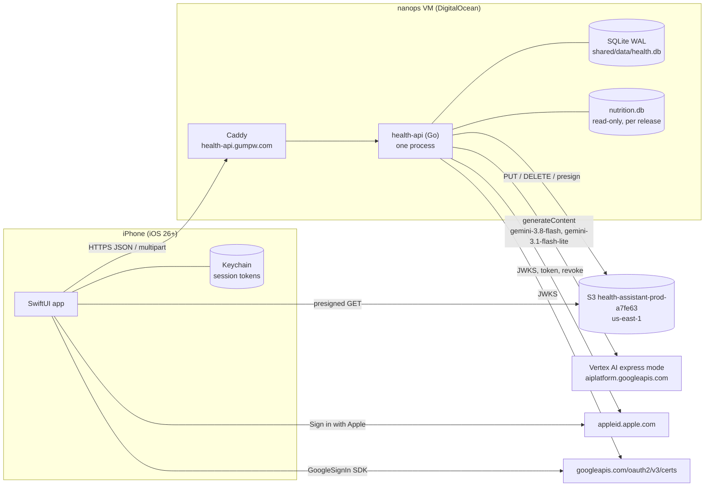
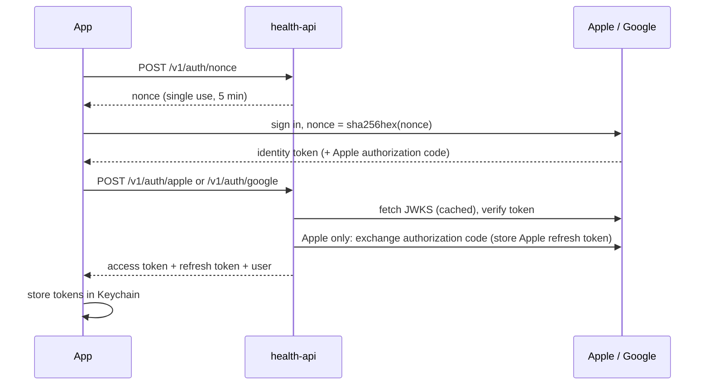
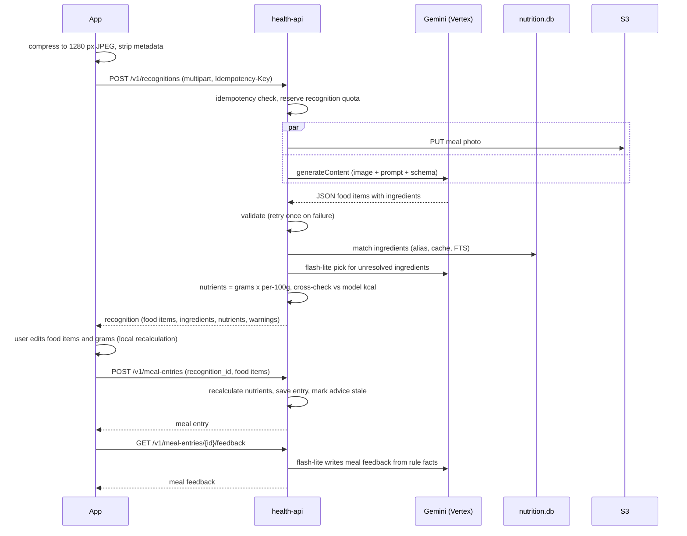
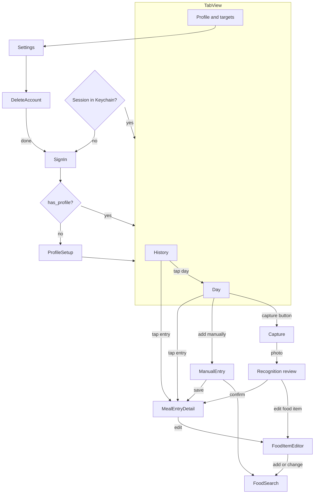

# Technical design: Health Assistant v1

Status: Draft, 2026-11-22. This document follows the decisions in [ADR 0001–0013](../adrs/) and uses the terms in the [glossary](../glossary.md). Identifiers come from [external setup](../external-setup.md). Facts that are not verified are marked **TODO**.

Scope of v1: an iOS 26+ app (SwiftUI, zh-Hans and en) and one Go backend. The user signs in with Apple or Google, takes a meal photo, checks the recognition, confirms a meal entry, and sees the day with a daily summary. The app is online only and has no push notifications.

## 1. Architecture overview



Components:

| Component | Responsibility |
|---|---|
| iOS app | UI, camera and photo picker, image compression, sign-in UI, local recalculation while the user edits grams. It does not calculate the stored nutrients or the daily target. |
| health-api | Auth, sessions, recognition pipeline, nutrition lookup, meal entries, daily target, health advice, quota, account deletion. |
| SQLite `health.db` | All user data (ADR 0008). |
| `nutrition.db` | Read-only USDA FoodData Central subset and curated aliases. Built in CI, shipped in each release. Not user data, not backed up. |
| S3 | Compressed meal photos only (ADR 0007). |
| Vertex AI | Recognition (`gemini-3.8-flash`, ADR 0001), ingredient match pick and health advice text (`gemini-3.1-flash-lite`, ADR 0012). |

### 1.1 Data flows

**Sign in**



**Photo → recognition → confirm → meal entry**



**Day view with daily summary**: the app calls `GET /v1/days/{date}`. The response has the meal entries, the totals, the daily target, and the daily summary only if it is fresh. If the day has at least one meal entry and no fresh summary, the app calls `GET /v1/days/{date}/summary`, which makes it (ADR 0012).

**Profile and targets**: `PUT /v1/me/profile` saves the profile and macro split. The backend calculates the daily target on read (ADR 0010) and marks all daily summaries of the user stale.

**Account deletion**: `DELETE /v1/me`. The backend revokes the Apple token (Apple users), deletes all meal photos in S3, deletes all rows of the user, and revokes all sessions (ADR 0004, 0007). Google users: the app also calls `GIDSignIn.sharedInstance.disconnect()`.

## 2. Go backend

### 2.1 Module layout

```
server/
  go.mod                      # module path: TODO (GitHub owner/repo)
  cmd/
    health-api/               # main: "serve" and "migrate" subcommands
    fdcimport/                # builds nutrition.db from FDC downloads + aliases
    eval/                     # offline recognition evaluation runner
  internal/
    config/                   # env parsing and validation
    httpapi/                  # router, handlers, middleware, error mapping
    auth/                     # Apple and Google token verify, sessions, Apple REST client
    store/                    # repository layer over database/sql (only place with SQL)
      migrations/             # 0001_init.sql, ... (embed.FS)
    recognition/              # pipeline, prompt, output schema, validation
    gemini/                   # thin Vertex AI REST client
    nutrition/                # lookup, matching, nutrient calculation, cross-check
      aliases.csv             # curated zh/en name -> fdc_id
      datasets.lock           # pinned FDC download URLs + SHA-256
    advice/                   # rule facts, text generation, cache
    target/                   # Mifflin-St Jeor daily target
    photo/                    # JPEG re-encode, S3 put/delete/presign
    quota/                    # recognition quota and global cost guard
    jobs/                     # in-process periodic cleanup
```

Rules: handlers call domain packages; only `store` contains SQL (ADR 0008); `gemini`, `auth` (Apple REST), and `photo` (S3) sit behind small interfaces so that tests use fakes.

### 2.2 Libraries

Go: latest stable (1.27.4 on 2026-11-22). Routing uses `net/http.ServeMux` method and path patterns. Logging uses `log/slog`. JSON uses `encoding/json`. JPEG uses `image/jpeg`.

| Library | Version (2026-11-22) | Why |
|---|---|---|
| `modernc.org/sqlite` | v1.62.0 | SQLite driver. See below. |
| `github.com/golang-jwt/jwt/v5` | v5.3.1 | Verify RS256 identity tokens, sign the ES256 Apple client secret. Mature, small. |
| `github.com/MicahParks/keyfunc/v3` | v3.9.2 | JWKS fetch, cache, and refresh on unknown `kid` for Apple and Google. Removes custom key-rotation code. |
| `github.com/aws/aws-sdk-go-v2/service/s3` (+ `config`, `feature/s3/presign` in the S3 package) | v1.116.0 | S3 put, delete, presigned GET. Official SDK; SigV4 by hand is not worth it. |
| `github.com/santhosh-tekuri/jsonschema/v6` | v6.0.3 | Validate model output against the same JSON Schema sent to Gemini. |
| `github.com/google/uuid` | latest | UUIDv7 IDs (time-ordered, good for SQLite B-tree inserts). |
| `golang.org/x/sync/singleflight` | latest | One advice generation per cache key at a time. |

Not used: a web framework (ServeMux is enough), an ORM (ADR 0008 asks for portable SQL behind one repository), the `google.golang.org/genai` SDK (we need one REST call; the Vertex `GenerationConfig` fields are in transition, see §6.2, and a thin client gives full control of the request body), a migration framework (see §2.4).

**SQLite driver: `modernc.org/sqlite` (pure Go).** Reasons: `CGO_ENABLED=0` gives one static linux binary built on the Ubuntu runner with no C toolchain or cross-compiler; the VM needs no shared libraries; `go test -race` and builds stay simple. Cost: it is slower than `mattn/go-sqlite3` (cgo). With one VM and few users this is not visible. Reconsider only if profiling shows the driver as a bottleneck. **TODO**: confirm FTS5 is available in the modernc build with a test in the first PR (§7 uses FTS5).

### 2.3 SQLite settings

- DSN: `file:<path>?_pragma=foreign_keys(1)&_pragma=journal_mode(WAL)&_pragma=busy_timeout(5000)&_pragma=synchronous(NORMAL)&_txlock=immediate`.
- Two `*sql.DB` pools on the same file: a write pool with `SetMaxOpenConns(1)` and a read pool with 4 connections. This avoids `SQLITE_BUSY` between writers.
- No write transaction stays open during a network call (model, S3, Apple).
- Time values are UTC text `2026-11-22T08:15:00.000Z`. IDs are UUIDv7 text. SQL stays portable to PostgreSQL (no SQLite-only types except FTS5 in `nutrition.db`).

### 2.4 Migrations

- Forward-only SQL files in `internal/store/migrations/NNNN_name.sql`, embedded with `embed.FS`.
- A small runner (about 60 lines) applies files in order, each in one transaction, and records them in `schema_migrations(version, applied_at)`. A framework adds little for one database and forward-only files.
- `health-api migrate` runs from `activate.sh` before the restart, after a pre-migration copy (§10). `serve` refuses to start if the database has unapplied or unknown migrations.
- Expand/contract rule: each migration must keep the previous release working, so that a rollback of the binary is safe without a down migration.

### 2.5 Configuration (env)

All config comes from env (`/opt/health-assistant/shared/.env` through project-env). `config.Load()` fails at start if a required value is missing. Names are listed in §10.4.

## 3. Auth

### 3.1 Nonce

`POST /v1/auth/nonce` returns a random 32-byte nonce (base64url). The backend stores `sha256(nonce)` with a 5-minute expiry. The app passes `sha256hex(nonce)` to Apple or Google. On sign-in, the backend checks that the token `nonce` claim equals `sha256hex(nonce)`, that the nonce exists, has not expired, and was not used, then marks it used. A server-issued, single-use nonce blocks replay of a stolen identity token.

### 3.2 Apple identity token

Per [Verifying a user](https://developer.apple.com/documentation/signinwithapple/verifying-a-user):

- Signature: RS256 with a key from `https://appleid.apple.com/auth/keys`, selected by `kid` (keyfunc cache). Accept only `RS256`.
- `iss` = `https://appleid.apple.com`.
- `aud` = `com.gumpw.health-assistant` (bundle ID, `APPLE_BUNDLE_ID`).
- `exp` in the future (60 s leeway). `iat` not more than 10 minutes old.
- `nonce` as in §3.1.
- User key: (`apple`, `sub`). Never merge by email (ADR 0004). Store `email` and `is_private_email` only for display and support.
- Apple sends the full name only at the first authorization. The app sends it in the request; the backend stores it if the user has no name.

**Apple refresh token for revocation.** The app also sends `authorizationCode`. The backend calls `POST https://appleid.apple.com/auth/token` with `grant_type=authorization_code` ([Generate and validate tokens](https://developer.apple.com/documentation/signinwithapplerestapi/generate-and-validate-tokens)). The code is single use and valid for 5 minutes. The backend stores the returned `refresh_token` encrypted with AES-256-GCM (`TOKEN_ENCRYPTION_KEY`). If the exchange fails, sign-in still succeeds; the backend logs a warning and asks for a fresh code at deletion (§3.6).

`client_secret` for `/auth/token` and `/auth/revoke` is an ES256 JWT: header `alg=ES256`, `kid=<key ID>`; claims `iss=HC438T2B8P`, `iat`, `exp` (at most 15777000 s, we use 1 hour and cache it), `aud=https://appleid.apple.com`, `sub=com.gumpw.health-assistant` ([client secret format](https://developer.apple.com/documentation/accountorganizationaldatasharing/creating-a-client-secret)).

**Extra Apple setup needed (not done yet, see §13):**

1. In Certificates, Identifiers & Profiles → Keys, create a key with "Sign in with Apple" enabled, primary App ID `com.gumpw.health-assistant`. Download the `.p8` once. Record the Key ID.
2. Put `APPLE_SIWA_KEY_ID` and `APPLE_SIWA_PRIVATE_KEY` (base64 of the `.p8`) in project-env through a PR.
3. Optional but recommended by Apple: set the server-to-server notification endpoint `https://health-api.gumpw.com/v1/webhooks/apple` for the App ID's Sign in with Apple configuration ([account deletion guidance](https://developer.apple.com/support/offering-account-deletion-in-your-app/)). **TODO**: confirm where the portal shows this field for an App ID without a Services ID.

### 3.3 Google ID token

Per [Authenticate with a backend server](https://developers.google.com/identity/sign-in/ios/backend-auth):

- Signature with keys from `https://www.googleapis.com/oauth2/v3/certs` (keyfunc cache, honors rotation).
- `iss` ∈ {`accounts.google.com`, `https://accounts.google.com`}.
- `aud` = `425467050521-4qi7lq179gc5ljikm4r1iat7c0iqd6ud.apps.googleusercontent.com` (iOS client ID, `GOOGLE_IOS_CLIENT_ID`). The app does not set a `serverClientID`, so the ID token audience is the iOS client.
- `exp` in the future. `nonce` as in §3.1. GoogleSignIn 9.0.0+ accepts a custom nonce ([release notes](https://github.com/google/GoogleSignIn-iOS/releases)). **TODO**: confirm the exact Swift method signature in 10.1.0.
- User key: (`google`, `sub`). Do not use `tokeninfo` in production.

### 3.4 Server session

Opaque tokens, not JWTs. One process and one database make a lookup cheap, and opaque tokens revoke at once.

| Token | Format | Lifetime | Storage on server |
|---|---|---|---|
| Access token | `ha_at_` + 32 random bytes base64url | 1 hour | `sha256` in `sessions.access_token_hash` |
| Refresh token | `ha_rt_` + 32 random bytes base64url | 60 days, sliding | `sha256` in `sessions.refresh_token_hash` |

- `Authorization: Bearer <access token>` on every authenticated call.
- `POST /v1/auth/refresh` rotates both tokens: it creates a new session row in the same `family_id` and marks the old row `rotated_at`. A rotated refresh token used again within 30 s returns the same new pair (lost response on a flaky network). After that, reuse revokes the full family (theft signal) and returns `401 session_revoked`.
- `POST /v1/auth/logout` revokes the family. Account deletion revokes all families.
- App storage: Keychain, `kSecClassGenericPassword`, service `com.gumpw.health-assistant.session`, `kSecAttrAccessibleAfterFirstUnlockThisDeviceOnly`, no iCloud sync.
- The app refreshes when it gets `401 token_expired`, with one refresh in flight at a time (§9.4).

### 3.5 Apple server-to-server notifications

`POST /v1/webhooks/apple` receives `{"payload": "<JWT>"}`. The backend verifies it with the same Apple JWKS (`iss` Apple, `aud` bundle ID). Event `account-delete` or `consent-revoked` for a known `sub` → delete that user as in §3.6 (skip the revoke call). Other events → log only. Always return 200 after a valid signature.

### 3.6 Account deletion

`DELETE /v1/me` with optional body `{"apple_authorization_code": "..."}`.

1. Mark the user `deleting` and revoke all sessions (one transaction).
2. Apple users: get an Apple refresh token (stored one, or exchange the given code), then `POST https://appleid.apple.com/auth/revoke` with `token_type_hint=refresh_token` ([Revoke tokens](https://developer.apple.com/documentation/signinwithapplerestapi/revoke-tokens)). Apple returns 200 also for a token that is already invalid. If there is no usable token, return `409 apple_reauth_required`; the app runs Sign in with Apple again and repeats the call with the new code.
3. Delete all meal photo objects by the keys in `meal_photos`. Failed deletes go to `photo_deletions` and a job retries them.
4. Delete the user row. Foreign keys cascade to all user data.
5. Return 204.

Backups of `health.db` keep deleted rows for up to 30 days (nanops lifecycle). The privacy policy must state this (§13).

## 4. SQLite schema

`health.db` (migration `0001_init.sql`):

```sql
CREATE TABLE users (
  id               TEXT PRIMARY KEY,
  provider         TEXT NOT NULL CHECK (provider IN ('apple', 'google')),
  provider_subject TEXT NOT NULL,
  email            TEXT,
  email_is_private INTEGER NOT NULL DEFAULT 0,
  display_name     TEXT,
  locale           TEXT NOT NULL DEFAULT 'en',      -- 'en' | 'zh-Hans', from Accept-Language
  state            TEXT NOT NULL DEFAULT 'active' CHECK (state IN ('active', 'deleting')),
  created_at       TEXT NOT NULL,
  UNIQUE (provider, provider_subject)                -- ADR 0004: one user per sign-in identity
);

CREATE TABLE apple_credentials (
  user_id           TEXT PRIMARY KEY REFERENCES users(id) ON DELETE CASCADE,
  refresh_token_enc BLOB NOT NULL,                   -- AES-256-GCM, nonce || ciphertext
  updated_at        TEXT NOT NULL
);

CREATE TABLE auth_nonces (
  nonce_hash TEXT PRIMARY KEY,
  expires_at TEXT NOT NULL,
  used_at    TEXT
);

CREATE TABLE sessions (
  id                 TEXT PRIMARY KEY,
  user_id            TEXT NOT NULL REFERENCES users(id) ON DELETE CASCADE,
  family_id          TEXT NOT NULL,
  access_token_hash  TEXT NOT NULL UNIQUE,
  access_expires_at  TEXT NOT NULL,
  refresh_token_hash TEXT NOT NULL UNIQUE,
  refresh_expires_at TEXT NOT NULL,
  rotated_at         TEXT,
  revoked_at         TEXT,
  created_at         TEXT NOT NULL
);
CREATE INDEX sessions_family ON sessions(family_id);
CREATE INDEX sessions_user ON sessions(user_id);

CREATE TABLE profiles (
  user_id        TEXT PRIMARY KEY REFERENCES users(id) ON DELETE CASCADE,
  sex            TEXT NOT NULL CHECK (sex IN ('male', 'female')),
  birth_year     INTEGER NOT NULL,                   -- age = current year - birth_year
  height_cm      REAL NOT NULL CHECK (height_cm BETWEEN 100 AND 250),
  weight_kg      REAL NOT NULL CHECK (weight_kg BETWEEN 30 AND 300),
  activity_level TEXT NOT NULL CHECK (activity_level IN ('sedentary', 'light', 'moderate', 'active', 'very_active')),
  goal           TEXT NOT NULL CHECK (goal IN ('lose', 'keep', 'gain')),
  protein_pct    INTEGER NOT NULL DEFAULT 25,
  fat_pct        INTEGER NOT NULL DEFAULT 30,
  carb_pct       INTEGER NOT NULL DEFAULT 45,
  updated_at     TEXT NOT NULL,
  CHECK (protein_pct + fat_pct + carb_pct = 100)
);

CREATE TABLE meal_photos (
  id         TEXT PRIMARY KEY,
  user_id    TEXT NOT NULL REFERENCES users(id) ON DELETE CASCADE,
  s3_key     TEXT NOT NULL UNIQUE,                   -- meal-photos/<user_id>/<photo_id>.jpg
  width      INTEGER NOT NULL,
  height     INTEGER NOT NULL,
  bytes      INTEGER NOT NULL,
  created_at TEXT NOT NULL
);

-- A recognition is immutable after it completes. It is not a record (glossary).
CREATE TABLE recognitions (
  id                 TEXT PRIMARY KEY,
  user_id            TEXT NOT NULL REFERENCES users(id) ON DELETE CASCADE,
  idempotency_key    TEXT NOT NULL,
  request_hash       TEXT NOT NULL,                  -- sha256 of photo bytes + meta
  photo_id           TEXT REFERENCES meal_photos(id) ON DELETE SET NULL,
  status             TEXT NOT NULL CHECK (status IN ('pending', 'succeeded', 'failed')),
  is_food            INTEGER,
  model              TEXT NOT NULL,                  -- e.g. gemini-3.8-flash
  prompt_version     TEXT NOT NULL,
  nutrition_version  TEXT,
  model_output_json  TEXT,                           -- raw validated model JSON (original recognition)
  result_json        TEXT,                           -- normalized food items + matches + nutrients
  error_code         TEXT,
  attempts           INTEGER NOT NULL DEFAULT 0,
  input_tokens       INTEGER,
  output_tokens      INTEGER,
  thought_tokens     INTEGER,
  latency_ms         INTEGER,
  taken_at           TEXT NOT NULL,                  -- UTC, from the app
  utc_offset_minutes INTEGER NOT NULL,
  quota_date         TEXT NOT NULL,                  -- local date used for the recognition quota
  created_at         TEXT NOT NULL,
  completed_at       TEXT,
  UNIQUE (user_id, idempotency_key)
);
CREATE INDEX recognitions_unconfirmed ON recognitions(status, created_at);

CREATE TABLE meal_entries (
  id                      TEXT PRIMARY KEY,
  user_id                 TEXT NOT NULL REFERENCES users(id) ON DELETE CASCADE,
  source                  TEXT NOT NULL CHECK (source IN ('recognition', 'manual')),
  recognition_id          TEXT UNIQUE REFERENCES recognitions(id),   -- one entry per recognition
  photo_id                TEXT REFERENCES meal_photos(id) ON DELETE SET NULL,
  meal_type               TEXT NOT NULL CHECK (meal_type IN ('breakfast', 'lunch', 'dinner', 'snack')),
  eaten_at                TEXT NOT NULL,             -- UTC (ADR 0011)
  utc_offset_minutes      INTEGER NOT NULL CHECK (utc_offset_minutes BETWEEN -720 AND 840),
  entry_date              TEXT NOT NULL,             -- local date of eaten_at + offset, never recalculated
  confirmed_snapshot_json TEXT,                      -- food items as first confirmed (eval pair)
  edited_after_confirm    INTEGER NOT NULL DEFAULT 0,
  created_at              TEXT NOT NULL,
  updated_at              TEXT NOT NULL,
  CHECK ((source = 'recognition') = (recognition_id IS NOT NULL))
);
CREATE INDEX meal_entries_day ON meal_entries(user_id, entry_date);
CREATE INDEX meal_entries_history ON meal_entries(user_id, eaten_at DESC, id DESC);

CREATE TABLE food_items (
  id               TEXT PRIMARY KEY,
  meal_entry_id    TEXT NOT NULL REFERENCES meal_entries(id) ON DELETE CASCADE,
  position         INTEGER NOT NULL,
  name_zh          TEXT,
  name_en          TEXT,
  cooking_method   TEXT NOT NULL,
  model_confidence REAL,                              -- null for manual items
  model_kcal       REAL,                              -- model's own estimate, cross-check only (ADR 0002)
  needs_gram_check INTEGER NOT NULL DEFAULT 0,
  UNIQUE (meal_entry_id, position)
);

-- Nutrient snapshot: values are fixed at save time and do not change if nutrition.db changes.
CREATE TABLE ingredients (
  id                TEXT PRIMARY KEY,
  food_item_id      TEXT NOT NULL REFERENCES food_items(id) ON DELETE CASCADE,
  position          INTEGER NOT NULL,
  name_zh           TEXT,
  name_en           TEXT,
  is_cooking_oil    INTEGER NOT NULL DEFAULT 0,
  grams             REAL NOT NULL CHECK (grams > 0 AND grams <= 5000),
  fdc_id            INTEGER NOT NULL,
  fdc_description   TEXT NOT NULL,
  nutrition_version TEXT NOT NULL,
  match_method      TEXT NOT NULL CHECK (match_method IN ('alias', 'cache', 'fts', 'model', 'user')),
  kcal              REAL NOT NULL,
  protein_g         REAL NOT NULL,
  fat_g             REAL NOT NULL,
  carb_g            REAL NOT NULL,
  fiber_g           REAL,
  sodium_mg         REAL,
  UNIQUE (food_item_id, position)
);

-- Health advice cache (ADR 0005, 0012).
CREATE TABLE advice (
  id            TEXT PRIMARY KEY,
  user_id       TEXT NOT NULL REFERENCES users(id) ON DELETE CASCADE,
  kind          TEXT NOT NULL CHECK (kind IN ('meal_feedback', 'daily_summary')),
  meal_entry_id TEXT REFERENCES meal_entries(id) ON DELETE CASCADE,
  entry_date    TEXT,
  locale        TEXT NOT NULL,
  facts_json    TEXT NOT NULL,
  facts_hash    TEXT NOT NULL,
  text          TEXT NOT NULL,
  model         TEXT NOT NULL,                       -- gemini-3.1-flash-lite or 'template'
  stale         INTEGER NOT NULL DEFAULT 0,
  generated_at  TEXT NOT NULL,
  CHECK ((kind = 'meal_feedback' AND meal_entry_id IS NOT NULL AND entry_date IS NULL)
      OR (kind = 'daily_summary' AND meal_entry_id IS NULL AND entry_date IS NOT NULL))
);
CREATE UNIQUE INDEX advice_meal ON advice(meal_entry_id, locale) WHERE kind = 'meal_feedback';
CREATE UNIQUE INDEX advice_day ON advice(user_id, entry_date, locale) WHERE kind = 'daily_summary';

CREATE TABLE recognition_quota (
  user_id    TEXT NOT NULL REFERENCES users(id) ON DELETE CASCADE,
  quota_date TEXT NOT NULL,
  used       INTEGER NOT NULL DEFAULT 0,
  PRIMARY KEY (user_id, quota_date)
);

CREATE TABLE model_usage_daily (                     -- global cost guard and reporting
  usage_date    TEXT NOT NULL,                       -- UTC date
  model         TEXT NOT NULL,
  purpose       TEXT NOT NULL CHECK (purpose IN ('recognition', 'match', 'advice')),
  requests      INTEGER NOT NULL DEFAULT 0,
  input_tokens  INTEGER NOT NULL DEFAULT 0,
  output_tokens INTEGER NOT NULL DEFAULT 0,
  PRIMARY KEY (usage_date, model, purpose)
);

CREATE TABLE ingredient_matches (                    -- learned name -> FDC food, global
  name_key          TEXT PRIMARY KEY,                -- normalized name_en
  fdc_id            INTEGER NOT NULL,
  method            TEXT NOT NULL CHECK (method IN ('model')),
  nutrition_version TEXT NOT NULL,
  created_at        TEXT NOT NULL
);

CREATE TABLE idempotency_keys (                      -- for POST /v1/meal-entries
  user_id       TEXT NOT NULL REFERENCES users(id) ON DELETE CASCADE,
  key           TEXT NOT NULL,
  request_hash  TEXT NOT NULL,
  status_code   INTEGER NOT NULL,
  response_json TEXT NOT NULL,
  created_at    TEXT NOT NULL,
  PRIMARY KEY (user_id, key)
);

CREATE TABLE photo_deletions (                       -- retry queue, survives user deletion
  s3_key     TEXT PRIMARY KEY,
  attempts   INTEGER NOT NULL DEFAULT 0,
  last_error TEXT,
  created_at TEXT NOT NULL
);
```

Notes:

- **Recognition vs meal entry.** A recognition keeps the original model output (`model_output_json`) and the normalized result (`result_json`); it never changes. A meal entry has relational food items and ingredients, which the user can edit. `recognition_id` links them. `confirmed_snapshot_json` keeps the food items as first confirmed. The pair (recognition, current meal entry) and the snapshot are the evaluation data (ADR 0003, 0012). Deleting a meal entry deletes its recognition and meal photo (ADR 0007): the repository deletes them in the same transaction and queues the S3 key.
- **Daily totals** are `SUM` over ingredients joined by `entry_date`. No stored totals.
- **Daily target** is not stored. It is calculated from `profiles` (§8.1).
- **Unconfirmed recognitions** and their photos are deleted after 7 days by a job.
- **Staleness**: the repository sets `advice.stale = 1` in the same transaction as the change: create, update, or delete of a meal entry → daily summary of that `entry_date` (both dates if `entry_date` changes) and the meal feedback of that entry; profile change → all daily summaries and meal feedback of the user. As a second guard, the facts hash is compared on read (§8.3).

`nutrition.db` (built by `cmd/fdcimport`, read-only):

```sql
CREATE TABLE meta (key TEXT PRIMARY KEY, value TEXT NOT NULL);  -- nutrition_version, dataset files, SHA-256
CREATE TABLE foods (
  fdc_id      INTEGER PRIMARY KEY,
  data_type   TEXT NOT NULL CHECK (data_type IN ('foundation', 'sr_legacy', 'fndds')),
  description TEXT NOT NULL,
  category    TEXT,
  kcal        REAL NOT NULL,       -- per 100 g
  protein_g   REAL NOT NULL,
  fat_g       REAL NOT NULL,
  carb_g      REAL NOT NULL,
  fiber_g     REAL,
  sodium_mg   REAL
);
CREATE VIRTUAL TABLE foods_fts USING fts5(description, content='foods', content_rowid='fdc_id');
CREATE TABLE aliases (
  alias  TEXT NOT NULL,            -- normalized
  lang   TEXT NOT NULL CHECK (lang IN ('zh', 'en')),
  fdc_id INTEGER NOT NULL REFERENCES foods(fdc_id),
  PRIMARY KEY (alias, lang)
);
```

## 5. REST API

Base URL `https://health-api.gumpw.com`. All bodies are JSON (UTF-8) except the photo upload. Field names are `snake_case`. Times are RFC 3339 UTC. Dates are `YYYY-MM-DD`. Every request sends `Accept-Language` (`zh-Hans` or `en`); the backend uses it for health advice text and updates `users.locale`. Every response has `X-Request-Id`. API fixtures for both sides live in `docs/api/fixtures/` (§11).

### 5.1 Errors

```json
{
  "error": {
    "code": "quota_exceeded",
    "message": "Daily recognition quota is used up.",
    "details": { "limit": 30, "resets_at": "2026-11-22T16:00:00Z" }
  },
  "request_id": "01JDF3..."
}
```

`message` is for logs and debugging. The app shows localized text by `code`.

| HTTP | `code` | When |
|---|---|---|
| 400 | `invalid_request` | Bad JSON, missing or invalid field (`details.field`) |
| 400 | `invalid_photo` | Not a JPEG, cannot decode, longest side > 1600 px |
| 401 | `unauthenticated` | No or unknown access token |
| 401 | `token_expired` | Access token expired; refresh |
| 401 | `session_revoked` | Refresh token revoked or reused |
| 401 | `invalid_identity_token` | Apple or Google token check failed (`details.reason`) |
| 403 | `forbidden` | Resource of another user (returned as 404 for IDs, see below) |
| 404 | `not_found` | Unknown ID or ID of another user |
| 409 | `idempotency_key_reused` | Same key, different request body |
| 409 | `recognition_in_progress` | Same key, first request still running |
| 409 | `recognition_already_confirmed` | Recognition has a meal entry (`details.meal_entry_id`) |
| 409 | `apple_reauth_required` | Account deletion needs a fresh Apple authorization code |
| 413 | `payload_too_large` | Photo > 2 MB, body > 64 KB |
| 422 | `unresolved_ingredient` | Meal entry has an ingredient without `fdc_id` |
| 429 | `quota_exceeded` | Recognition quota used up |
| 429 | `rate_limited` | Per-user request rate (`Retry-After`) |
| 502 | `model_output_invalid` | Model output failed validation twice |
| 503 | `model_unavailable` | Model timeout, 429, or 5xx; or global cost guard reached |
| 500 | `internal` | Other |

### 5.2 Endpoints

| Method | Path | Auth | Purpose |
|---|---|---|---|
| GET | `/healthz` | no | Health probe |
| POST | `/v1/auth/nonce` | no | Get sign-in nonce |
| POST | `/v1/auth/apple` | no | Sign in with Apple |
| POST | `/v1/auth/google` | no | Sign in with Google |
| POST | `/v1/auth/refresh` | no | Rotate tokens |
| POST | `/v1/auth/logout` | yes | Revoke session family |
| POST | `/v1/webhooks/apple` | Apple JWT | Apple account events |
| GET | `/v1/me` | yes | User, profile, daily target, quota |
| PUT | `/v1/me/profile` | yes | Create or replace profile |
| DELETE | `/v1/me` | yes | Delete account |
| POST | `/v1/recognitions` | yes | Upload meal photo and recognize |
| GET | `/v1/recognitions/{id}` | yes | Get a recognition (after a lost response) |
| GET | `/v1/foods/search` | yes | Search nutrition database (manual input, change ingredient) |
| POST | `/v1/meal-entries` | yes | Confirm a recognition or create a manual meal entry |
| GET | `/v1/meal-entries` | yes | History, cursor pagination |
| GET | `/v1/meal-entries/{id}` | yes | One meal entry |
| PUT | `/v1/meal-entries/{id}` | yes | Replace food items, meal type, eaten time |
| DELETE | `/v1/meal-entries/{id}` | yes | Delete entry, recognition, photo |
| GET | `/v1/meal-entries/{id}/feedback` | yes | Meal feedback (made if missing or stale) |
| GET | `/v1/days/{date}` | yes | Day view |
| GET | `/v1/days/{date}/summary` | yes | Daily summary (made if missing or stale) |
| GET | `/v1/days?from=&to=` | yes | Per-day totals for a calendar (max 62 days) |

**`GET /healthz`** → `200 {"status":"ok","version":"<git sha>"}`. Checks only that the process runs and `SELECT 1` works. No third-party calls.

**`POST /v1/auth/nonce`** → `200 {"nonce":"q8Zr...","expires_at":"2026-11-22T08:20:00Z"}`

**`POST /v1/auth/apple`**

```json
{
  "identity_token": "eyJraWQi...",
  "authorization_code": "c1a2...",
  "nonce": "q8Zr...",
  "full_name": { "given_name": "Gang", "family_name": "Wang" }
}
```

**`POST /v1/auth/google`** → `{"id_token":"eyJhbGci...","nonce":"q8Zr..."}`

Both return `200` (`201` when a new user is created):

```json
{
  "access_token": "ha_at_...",
  "access_expires_at": "2026-11-22T09:15:00Z",
  "refresh_token": "ha_rt_...",
  "refresh_expires_at": "2027-01-21T08:15:00Z",
  "user": { "id": "0193...", "provider": "apple", "display_name": "Gang Wang", "email": "x@privaterelay.appleid.com", "has_profile": false }
}
```

**`POST /v1/auth/refresh`** → `{"refresh_token":"ha_rt_..."}` → same token fields as above.

**`GET /v1/me`**

```json
{
  "user": { "id": "0193...", "provider": "google", "display_name": "Gump", "email": "g@example.com" },
  "profile": {
    "sex": "male", "birth_year": 1990, "height_cm": 175, "weight_kg": 70,
    "activity_level": "light", "goal": "lose",
    "macro_split": { "protein_pct": 25, "fat_pct": 30, "carb_pct": 45 }
  },
  "daily_target": { "kcal": 2032, "protein_g": 127, "fat_g": 68, "carb_g": 229 },
  "recognition_quota": { "limit": 30, "used": 4, "resets_at": "2026-11-22T16:00:00Z" }
}
```

`profile` and `daily_target` are `null` if the user skipped onboarding. `daily_target` is `null` if age < 18 (ADR 0010).

**`PUT /v1/me/profile`**: body is the `profile` object above. Response = `GET /v1/me`.

**`DELETE /v1/me`**: body `{"apple_authorization_code": "c9f..."}` (optional) → `204`, or `409 apple_reauth_required`.

**`POST /v1/recognitions`**

Headers: `Idempotency-Key: <UUID>` (required; the app makes one per meal photo and reuses it on retry). Body `multipart/form-data`:

- `photo`: `image/jpeg`, ≤ 2 MB.
- `meta`: JSON `{"taken_at":"2026-11-22T04:12:00Z","utc_offset_minutes":480}`.

Response `201` (new) or `200` (replay of a completed request with the same key):

```json
{
  "id": "0193a1...",
  "status": "succeeded",
  "is_food": true,
  "photo_url": "https://health-assistant-prod-a7fe63.s3.us-east-1.amazonaws.com/...&X-Amz-Expires=900",
  "suggested_meal_type": "lunch",
  "food_items": [
    {
      "name_zh": "番茄炒蛋", "name_en": "Tomato and egg stir-fry",
      "cooking_method": "stir_fried", "confidence": 0.86,
      "model_kcal": 260, "needs_gram_check": false,
      "ingredients": [
        { "name_zh": "番茄", "name_en": "tomato, raw", "grams": 150, "is_cooking_oil": false,
          "food": { "fdc_id": 170457, "description": "Tomatoes, red, ripe, raw, year round average",
                    "per_100g": { "kcal": 18, "protein_g": 0.88, "fat_g": 0.2, "carb_g": 3.89, "fiber_g": 1.2, "sodium_mg": 5 } },
          "nutrients": { "kcal": 27, "protein_g": 1.3, "fat_g": 0.3, "carb_g": 5.8, "fiber_g": 1.8, "sodium_mg": 7.5 },
          "match_method": "alias", "candidates": [] },
        { "name_zh": "鸡蛋", "name_en": "egg, scrambled", "grams": 100, "is_cooking_oil": false, "food": { "...": "..." }, "nutrients": { "...": "..." }, "match_method": "fts", "candidates": [] },
        { "name_zh": "植物油", "name_en": "vegetable oil", "grams": 10, "is_cooking_oil": true, "food": { "...": "..." }, "nutrients": { "...": "..." }, "match_method": "alias", "candidates": [] }
      ],
      "nutrients": { "kcal": 263, "protein_g": 11.6, "fat_g": 20.1, "carb_g": 6.9 }
    }
  ],
  "nutrients": { "kcal": 263, "protein_g": 11.6, "fat_g": 20.1, "carb_g": 6.9 },
  "recognition_quota": { "limit": 30, "used": 5, "resets_at": "2026-11-22T16:00:00Z" }
}
```

(The FDC IDs and values above are examples, not checked.) An ingredient without a match has `"food": null`, `"nutrients": null`, and up to 5 `candidates` (`fdc_id`, `description`, `per_100g`). `is_food: false` returns `food_items: []` and still counts against the quota.

Idempotency: the key is unique per user. Same key and same `request_hash` → return the stored result (`200`), or `409 recognition_in_progress` while it runs. Same key with a different body → `409 idempotency_key_reused`. The pipeline runs in a context that is not cancelled when the client disconnects (`context.WithoutCancel` + 60 s timeout), so a retry after a lost response finds the result. The app can also call `GET /v1/recognitions/{id}` when it has the ID.

**Photo upload decision: upload through the backend, not a presigned S3 PUT.** Reasons: (1) the backend must send the image bytes inline to Gemini (express mode cannot read S3), so a presigned PUT needs one more S3 download; (2) one request gives one idempotency boundary for upload, quota, and recognition; (3) the backend re-encodes the JPEG (stdlib `image/jpeg`, quality 85), which checks the format and size and removes all metadata (for example GPS) before storage; (4) photos are about 150–300 KB, so the VM bandwidth cost is small. Cost: the upload passes through Caddy and the VM. Reads use presigned GET URLs (15 minutes), as ADR 0007 requires.

**`GET /v1/foods/search?q=鸡胸肉&limit=10`** → `{"foods":[{"fdc_id":171477,"description":"Chicken, broilers or fryers, breast, meat only, cooked, roasted","data_type":"sr_legacy","per_100g":{...}}]}`. Searches aliases first, then FTS5.

**`POST /v1/meal-entries`**

Header `Idempotency-Key` (required). Body:

```json
{
  "recognition_id": "0193a1...",
  "meal_type": "lunch",
  "eaten_at": "2026-11-22T04:12:00Z",
  "utc_offset_minutes": 480,
  "food_items": [
    {
      "name_zh": "番茄炒蛋", "name_en": "Tomato and egg stir-fry", "cooking_method": "stir_fried",
      "ingredients": [
        { "name_zh": "番茄", "name_en": "tomato, raw", "grams": 180, "fdc_id": 170457, "is_cooking_oil": false },
        { "name_zh": "鸡蛋", "name_en": "egg, scrambled", "grams": 100, "fdc_id": 172188, "is_cooking_oil": false },
        { "name_zh": "植物油", "name_en": "vegetable oil", "grams": 10, "fdc_id": 172370, "is_cooking_oil": true }
      ]
    }
  ]
}
```

Manual input: omit `recognition_id`. The backend ignores any client nutrients, recalculates them from `nutrition.db`, sets `entry_date`, and copies `model_confidence`, `model_kcal`, and `needs_gram_check` from the recognition for food items that match by position. Response `201` with the meal entry:

```json
{
  "id": "0193b2...",
  "source": "recognition",
  "recognition_id": "0193a1...",
  "meal_type": "lunch",
  "eaten_at": "2026-11-22T04:12:00Z",
  "utc_offset_minutes": 480,
  "entry_date": "2026-11-22",
  "photo_url": "https://...",
  "food_items": [ { "id": "...", "name_zh": "番茄炒蛋", "name_en": "Tomato and egg stir-fry", "cooking_method": "stir_fried", "needs_gram_check": false, "ingredients": [ { "id": "...", "grams": 180, "fdc_id": 170457, "nutrients": { "kcal": 32.4, "...": 0 } } ], "nutrients": { "kcal": 268 } } ],
  "nutrients": { "kcal": 268, "protein_g": 11.8, "fat_g": 20.2, "carb_g": 7.7, "fiber_g": 2.2, "sodium_mg": 150 },
  "created_at": "2026-11-22T04:13:10Z",
  "updated_at": "2026-11-22T04:13:10Z"
}
```

**`PUT /v1/meal-entries/{id}`**: same body as POST without `recognition_id`. Full replace of food items. Response `200` with the meal entry. Sets `edited_after_confirm = 1`.

**`DELETE /v1/meal-entries/{id}`** → `204`.

**`GET /v1/meal-entries?limit=20&cursor=<opaque>`** → `{"meal_entries":[...], "next_cursor":"eyJ0Ijoi..."}`. Order `eaten_at DESC, id DESC`. The cursor is base64url of the last `(eaten_at, id)`. `limit` max 50. `next_cursor` is `null` at the end.

**`GET /v1/meal-entries/{id}/feedback`** → `200 {"kind":"meal_feedback","text":"...","generated_at":"...","disclaimer_required":true}`. Blocks while the text is made (timeout 15 s); on failure it returns a template text built from the facts (`"model":"template"` is not exposed; text is always present).

**`GET /v1/days/2026-11-22`**

```json
{
  "date": "2026-11-22",
  "daily_target": { "kcal": 2032, "protein_g": 127, "fat_g": 68, "carb_g": 229 },
  "totals": { "kcal": 1240, "protein_g": 62, "fat_g": 48, "carb_g": 140, "fiber_g": 14, "sodium_mg": 1900 },
  "meal_entries": [ { "...": "meal entry, food items without ingredients" } ],
  "daily_summary": { "state": "stale", "text": null, "generated_at": null }
}
```

`daily_summary.state` ∈ `none` (no meal entries), `missing`, `stale`, `fresh`. Only `fresh` has `text`. A stale summary is never returned as text (ADR 0012).

**`GET /v1/days/2026-11-22/summary`** → `200 {"kind":"daily_summary","date":"2026-11-22","text":"...","generated_at":"..."}`, or `404 not_found` if the day has no meal entries.

**`GET /v1/days?from=2026-11-01&to=2026-11-30`** → `{"days":[{"date":"2026-11-01","kcal":1830,"entry_count":3}, ...]}`. Days without entries are omitted.

### 5.3 Rate limits

- Recognition quota: 30 recognitions per user per local day (§6.6).
- General: in-memory token bucket per user, 10 requests/s, burst 30. Unauthenticated auth endpoints: 10 requests/min per IP.

## 6. Recognition pipeline

### 6.1 Steps

1. Parse multipart. Reject > 2 MB or not JPEG. Decode, check longest side ≤ 1600 px, re-encode quality 85.
2. Idempotency check and quota reserve in one write transaction: insert `recognitions` row (`pending`), increment `recognition_quota.used`. If the global cost guard is reached, return `503 model_unavailable`.
3. In parallel: S3 PUT of the photo (`meal-photos/<user_id>/<photo_id>.jpg`, `Content-Type: image/jpeg`, SSE-S3 by bucket default) and the Gemini call.
4. Validate the output (§6.4). On failure, retry once with the validation errors added to the prompt.
5. Match ingredients and calculate nutrients (§7).
6. Cross-check per food item (§7.4).
7. Save `succeeded` with raw and normalized JSON, token counts, latency. Update `model_usage_daily`.
8. On final failure: status `failed`, refund the quota (decrement `used`), delete the photo, return 502 or 503.

### 6.2 Gemini request (Vertex AI express mode)

Endpoint (from [express mode API reference](https://docs.cloud.google.com/vertex-ai/generative-ai/docs/start/express-mode/vertex-ai-express-mode-api-reference)):

```
POST https://aiplatform.googleapis.com/v1/publishers/google/models/gemini-3.8-flash:generateContent
x-goog-api-key: $GEMINI_API_KEY
Content-Type: application/json
```

The key goes in the `x-goog-api-key` header, not the `key` query parameter, so that it does not appear in URLs or logs.

Body:

```json
{
  "systemInstruction": { "parts": [ { "text": "<system prompt, §6.3>" } ] },
  "contents": [ {
    "role": "user",
    "parts": [
      { "inlineData": { "mimeType": "image/jpeg", "data": "<base64>" } },
      { "text": "Local time: 12:12, Sunday. Meal type guess: lunch. Reply names in zh and en." }
    ]
  } ],
  "generationConfig": {
    "responseMimeType": "application/json",
    "responseSchema": { "...": "§6.4" },
    "maxOutputTokens": 2048,
    "thinkingConfig": { "thinkingLevel": "LOW" }
  }
}
```

Facts verified on 2026-11-22:

- [Structured output](https://docs.cloud.google.com/vertex-ai/generative-ai/docs/multimodal/control-generated-output) uses `generationConfig.responseMimeType: "application/json"` with `responseSchema` (OpenAPI subset). It lists Gemini 3.8 Flash and Gemini 3.1 Flash-Lite as supported. Supported keywords: `anyOf`, `enum` (strings), `format`, `items`, `maximum`, `minimum`, `maxItems`, `minItems`, `nullable`, `properties`, `description`, `propertyOrdering`, `required`. Unsupported keywords are ignored, not rejected. Complex schemas can return `400 INVALID_ARGUMENT`. Do not repeat the schema in the prompt.
- The [`GenerationConfig` reference](https://docs.cloud.google.com/vertex-ai/generative-ai/docs/reference/rest/v1/GenerationConfig) marks `responseMimeType`, `responseSchema`, and `responseJsonSchema` as deprecated in favor of `responseFormat: [{"text": {"mimeType": "APPLICATION_JSON", "schema": {...}}}]`. No removal date is given. `responseJsonSchema` and `responseSchema` are mutually exclusive.
- `thinkingConfig.thinkingLevel` accepts `MINIMAL`, `LOW`, `MEDIUM`, `HIGH`, `XHIGH`. `mediaResolution` accepts `LOW`, `MEDIUM`, `HIGH`.

Decision: the `gemini` package has one request builder. The first spike tests `responseFormat` on the express endpoint with both models. If it works, use it; else use `responseMimeType` + `responseSchema` (works today). **TODO**: record the result. The backend always validates the output itself (§6.4), so the choice does not change correctness.

Parameters to tune on the evaluation set (§12.3), not guessed now: `thinkingLevel` (`MINIMAL` vs `LOW`), `mediaResolution` (unset vs `MEDIUM`). Temperature stays at the model default. **TODO**: confirm Google's current guidance for temperature on Gemini 3.x.

Response handling: read `candidates[0].content.parts[*].text` (skip parts with `thought: true`), require `finishReason == "STOP"`, read `usageMetadata.promptTokenCount`, `candidatesTokenCount`, `thoughtsTokenCount`. `finishReason` `SAFETY` or `MAX_TOKENS` → retry once, then `502 model_output_invalid`.

### 6.3 Prompt outline (`prompt_version` = `rec-v1`)

System instruction (English; output names in both languages):

1. Role: you identify foods in one meal photo for a diet log. You do not give health advice.
2. If the photo shows no food or drink, set `is_food` false and return no food items.
3. List each food item (dish, drink, side) that the user eats. Merge identical portions; split shared plates only if portions are clear.
4. Split each food item into ingredients with grams **as served** (cooked weight for cooked parts). Describe the state in `name_en` so that a nutrition database can match it, for example "white rice, cooked", "pork belly, braised", "egg, scrambled".
5. Cooking oil: for stir-fried, pan-fried, deep-fried, or oil-dressed food items, add the oil as its own ingredient with `is_cooking_oil` true and an estimate of the absorbed grams (ADR 0009). Also add visible sauces and sugar as ingredients.
6. Estimate grams from visible cues: plate and bowl size, utensils, hands. Large portions are often underestimated; do not shrink them.
7. Give `estimated_kcal` per food item from your own knowledge. It is used only for a cross-check.
8. Give `confidence` 0–1 per food item for the identification.
9. Use Simplified Chinese for `name_zh`.

The user turn has the image, the local time, the weekday, and the suggested meal type (context metadata reduces error, see the research report §3).

### 6.4 Output schema

Sent as `responseSchema` (OpenAPI subset) and validated again in Go with the equivalent JSON Schema:

```json
{
  "type": "object",
  "properties": {
    "is_food": { "type": "boolean" },
    "food_items": {
      "type": "array",
      "maxItems": 12,
      "items": {
        "type": "object",
        "properties": {
          "name_zh": { "type": "string" },
          "name_en": { "type": "string" },
          "cooking_method": {
            "type": "string",
            "enum": ["raw", "boiled", "steamed", "stir_fried", "pan_fried", "deep_fried", "braised", "stewed", "roasted", "grilled", "baked", "other"]
          },
          "confidence": { "type": "number", "minimum": 0, "maximum": 1 },
          "estimated_kcal": { "type": "number", "minimum": 0, "maximum": 5000 },
          "ingredients": {
            "type": "array",
            "minItems": 1,
            "maxItems": 15,
            "items": {
              "type": "object",
              "properties": {
                "name_zh": { "type": "string" },
                "name_en": { "type": "string" },
                "grams": { "type": "number", "minimum": 0.5, "maximum": 2000 },
                "is_cooking_oil": { "type": "boolean" }
              },
              "required": ["name_zh", "name_en", "grams", "is_cooking_oil"],
              "propertyOrdering": ["name_zh", "name_en", "grams", "is_cooking_oil"]
            }
          }
        },
        "required": ["name_zh", "name_en", "cooking_method", "confidence", "estimated_kcal", "ingredients"],
        "propertyOrdering": ["name_zh", "name_en", "cooking_method", "ingredients", "estimated_kcal", "confidence"]
      }
    }
  },
  "required": ["is_food", "food_items"],
  "propertyOrdering": ["is_food", "food_items"]
}
```

`estimated_kcal` comes after `ingredients` so that the model states the parts first.

Validation in Go (beyond the schema; the model may ignore unsupported keywords):

- JSON parses; schema passes; numeric ranges hold.
- `is_food` false ⇒ `food_items` empty; `is_food` true ⇒ at least one food item.
- Names are not empty after trim.
- Food items with `stir_fried`, `pan_fried`, or `deep_fried` have exactly one ingredient with `is_cooking_oil` true. A second failure on only this rule is accepted with a warning (log only).
- Sum of grams per food item ≤ 3000.

### 6.5 Timeouts and retry

| Call | Timeout | Retry |
|---|---|---|
| Recognition `generateContent` | 30 s per attempt | 1 retry on validation failure, 429, 5xx, timeout (backoff 1 s) |
| Match pick (flash-lite) | 8 s | none; unresolved ingredients get candidates |
| Pipeline total | 60 s (detached context) | — |
| App request timeout | 75 s | the app retries with the same `Idempotency-Key` |

### 6.6 Cost guard

- Recognition quota: 30 per user per day (`RECOGNITION_DAILY_QUOTA`). `quota_date` = local date of the request time with `meta.utc_offset_minutes` (clamped to −720…+840). The retry inside one request counts once. A failed recognition is refunded. A non-food result counts.
- Global daily cap on recognition requests (`RECOGNITION_GLOBAL_DAILY_LIMIT`, UTC day). Default 500. At the cap, return `503 model_unavailable`, log an error, and send one Feishu alert per UTC day through `FEISHU_ALERT_WEBHOOK`.
- `maxOutputTokens` 2048; one image per request; 2 MB photo limit.
- Cost per call is logged from `usageMetadata`. Note the `gemini-3.8-flash` price doubles on 2027-01-01 (ADR 0001).

## 7. Nutrition lookup

### 7.1 USDA FoodData Central

Verified on 2026-11-22 ([API guide](https://fdc.nal.usda.gov/api-guide/), [downloads](https://fdc.nal.usda.gov/download-datasets/)):

- API base `https://api.nal.usda.gov/fdc/v1/`: `GET /food/{fdcId}`, `GET|POST /foods`, `GET|POST /foods/list`, `GET|POST /foods/search` (`query`, `dataType`, `pageSize`, `sortBy`). Key: data.gov `api_key`. Limit 1,000 requests/hour per IP; over the limit → HTTP 429 and a 1-hour block. License CC0; credit FoodData Central.
- Bulk downloads: Foundation Foods 10/2026 (JSON 681 KB zipped), SR Legacy 04/2018 (JSON 12.3 MB), FNDDS 10/2024 (JSON 3.7 MB), Branded 10/2026 (JSON 187 MB).

Decision: **no USDA API calls at runtime.** `cmd/fdcimport` reads the pinned JSON downloads and writes `nutrition.db`:

| Data type | Use | Why |
|---|---|---|
| Foundation | yes, first priority | Current analytical data for raw ingredients. |
| SR Legacy | yes | Broad coverage, many cooked states (for example cooked rice, roasted chicken). Frozen since 2018. |
| Survey (FNDDS) | yes, lower rank | Mixed and prepared foods (noodles, dumplings, soups) as a fallback. |
| Branded | no | Large, packaged products, barcode use is out of v1 scope. |

- Nutrients kept per 100 g: energy (kcal), protein, total fat, carbohydrate (by difference), fiber, sodium. Energy source order: nutrient 1008 (kcal), then 2048 (Atwater specific), then 2047 (Atwater general), else 4/9/4 from macros. **TODO**: verify these nutrient numbers against the downloaded files in the first import test.
- `datasets.lock` pins each file URL and SHA-256. **TODO**: record exact file names. `nutrition_version` = the three release tags, for example `fnd-2026-10+sr-2018-04+fndds-2024-10`.
- CI caches the downloads by the hash of `datasets.lock` and builds `nutrition.db` in each backend build (§11.3). An FDC key is not needed for downloads. `FDC_API_KEY` is only for manual exploration.

### 7.2 Ingredient name matching

Input: `name_en` and `name_zh` from the model. Steps, stop at the first hit:

1. **Alias** — exact match of the normalized `name_zh` or `name_en` in `aliases`. `server/nutrition/aliases.csv` is curated by hand: common Chinese ingredients and oils, sauces, staples (start with about 300 rows from the first evaluation runs). Normalization: NFKC, lower case, trim, collapse spaces, remove punctuation.
2. **Cache** — `ingredient_matches` by normalized `name_en` (results of earlier model picks for the same `nutrition_version`).
3. **Candidates** — FTS5 query on `foods_fts` with the `name_en` words (BM25), top 8, with a rank bonus for Foundation > SR Legacy > FNDDS and for state words that match ("raw", "cooked", "boiled", "fried").
4. **Model pick** — one `gemini-3.1-flash-lite` call per recognition for all unresolved ingredients. The response schema is built per request: an object with one property per ingredient (`i0`, `i1`, …), each an `enum` of its candidate `fdc_id` strings plus `"none"`. The model can only choose a candidate ID (research report §4.2, step 3). The pick is written to `ingredient_matches`.
5. **Unresolved** — `food: null` with the candidates. The app asks the user to choose or search (§5.2). A meal entry cannot be saved with an unresolved ingredient (`422 unresolved_ingredient`).

Embeddings are not used in v1. Add them only if the evaluation shows that FTS candidate recall is the main error.

### 7.3 Nutrient calculation

`nutrient = grams × per_100g / 100`, per ingredient, rounded to 0.1 at output only. Food item and meal entry values are sums. There is no extra per-method oil or sugar factor; oil is an ingredient (ADR 0009).

### 7.4 Cross-check (ADR 0002)

Per food item with all ingredients resolved: `diff = |db_kcal − model_kcal| / db_kcal`. If `db_kcal ≥ 30` and `diff > 0.35`, set `needs_gram_check = true`. The app shows a prompt on that food item to check the grams. The flag is stored on the food item and is cleared when the user changes grams of that food item.

## 8. Health advice

### 8.1 Daily target (ADR 0010)

- BMR (Mifflin-St Jeor): `10 × kg + 6.25 × cm − 5 × age + 5` (male), `… − 161` (female). Age = current year − `birth_year`.
- Activity factor: sedentary 1.2, light 1.375, moderate 1.55, active 1.725, very_active 1.9.
- Goal: lose ×0.85, keep ×1.0, gain ×1.10. Round kcal to integer.
- Macros: `protein_g = kcal × protein_pct / 400`, `fat_g = kcal × fat_pct / 900`, `carb_g = kcal × carb_pct / 400`.
- Age < 18 → no daily target. No profile → no target; the day view shows totals only.

### 8.2 Rule facts (ADR 0005)

The `advice` package builds facts with rules. The model never calculates.

Daily summary facts example:

```json
{
  "date": "2026-11-22",
  "has_target": true,
  "meal_count": 3,
  "meal_types": ["breakfast", "lunch", "dinner"],
  "eaten": { "kcal": 2310, "protein_g": 70, "fat_g": 95, "carb_g": 260, "fiber_g": 12, "sodium_mg": 3900 },
  "target": { "kcal": 2032, "protein_g": 127, "fat_g": 68, "carb_g": 229 },
  "pct_of_target": { "kcal": 114, "protein_g": 55, "fat_g": 140, "carb_g": 114 },
  "flags": ["kcal_over", "protein_low", "fat_high", "fiber_low", "sodium_high"],
  "top_kcal_items": [ { "name": "红烧肉", "kcal": 620 } ]
}
```

Rules (thresholds in one Go table, unit-tested): `kcal_over` > 110% of target, `kcal_under` < 80% (only when the day has ≥ 2 meal entries), macro `_high` > 120%, `_low` < 70%, `fiber_low` < 15 g, `sodium_high` > 2300 mg. Meal feedback facts: the entry totals, its share of the daily target, its macro energy shares (`fat_share_high` > 40% of energy, `protein_share_low` < 15%), and whether a food from FDC vegetable or fruit categories is present.

### 8.3 Text generation

- Model `gemini-3.1-flash-lite` (ADR 0012), same `gemini` client, schema `{"text": string}`.
- Prompt: write 2–3 short sentences in the user locale (`zh-Hans` or `en`) from the facts only; general diet information; no diseases, medicines, diagnoses, or supplements; do not add numbers that are not in the facts; friendly, not judging.
- Checks: length ≤ 160 characters (zh) or 320 (en); every number in the text appears in the facts (after rounding); a small deny-list of medical words per locale. One retry; then a template text from the facts (localized in Go).
- The app shows the "not medical advice" disclaimer with every health advice text (ADR 0005).

### 8.4 Cache and invalidation (ADR 0012)

- Key: meal feedback (`meal_entry_id`, `locale`); daily summary (`user_id`, `entry_date`, `locale`).
- Fresh means `stale = 0` and `facts_hash` equals the hash of the facts built now. The hash check also catches a missed invalidation (for example a change in thresholds after a deploy).
- Triggers that set `stale = 1` (same transaction as the change): meal entry create, update, delete (its date and its feedback; both dates on a date change); profile or macro split change (all advice of the user). Locale change needs no trigger: the key includes the locale.
- Meal feedback is made on the first `GET /v1/meal-entries/{id}/feedback` after confirmation (the app calls it at once). Daily summary is made on `GET /v1/days/{date}/summary`. `singleflight` per key prevents duplicate calls.

## 9. iOS app

### 9.1 Project

- XcodeGen `ios/project.yml` (same pattern as trlm). Target `HealthAssistant`, bundle ID `com.gumpw.health-assistant`, team `HC438T2B8P`, deployment target iOS 26.0, iPhone only, portrait. Swift 6 language mode (strict concurrency). Test target `HealthAssistantTests` hosted in the app (trlm TEST_HOST / BUNDLE_LOADER rules).
- Info.plist: `NSCameraUsageDescription`, `GIDClientID`, URL scheme `com.googleusercontent.apps.425467050521-4qi7lq179gc5ljikm4r1iat7c0iqd6ud`, `API_BASE_URL` from a build setting (Debug may point to a local server; Release `https://health-api.gumpw.com`), `ITSAppUsesNonExemptEncryption = false`, `CFBundleDevelopmentRegion = en`, `CFBundleLocalizations = [en, zh-Hans]`.
- Entitlements: `com.apple.developer.applesignin = [Default]`.
- `PrivacyInfo.xcprivacy`: no tracking; collected data: name, email (sign-in), photos, health and fitness data (meal and body data), other user content; all for app functionality, linked to the user. **TODO**: confirm the App Privacy categories with App Store Connect.
- Packages (SPM only): `GoogleSignIn-iOS` 10.1.0 (2026-10-23; CocoaPods distribution ends with this release, [releases](https://github.com/google/GoogleSignIn-iOS/releases)). No other third-party packages in v1.

### 9.2 Folder layout

```
ios/
  project.yml
  HealthAssistant/
    App/            HealthAssistantApp.swift, AppModel.swift, RootView.swift
    Features/
      SignIn/       SignInView, SignInModel (Apple + Google)
      Onboarding/   ProfileSetupView (skippable)
      Day/          DayView, DayModel, DailySummaryCard, TotalsRing
      Capture/      CameraView, CameraController (AVFoundation), PhotoPickerButton
      Review/       RecognitionReviewView, FoodItemEditor, IngredientEditor, ReviewModel
      FoodSearch/   FoodSearchView (manual input, change ingredient)
      MealEntry/    MealEntryDetailView, MealFeedbackCard
      History/      CalendarView, HistoryListView
      Profile/      ProfileView, TargetsView, SettingsView, DeleteAccountFlow
    Core/
      API/          APIClient, Endpoints, DTOs (Codable), APIError
      Auth/         SessionStore, AppleSignInCoordinator, GoogleSignInCoordinator, Nonce
      Keychain/     KeychainStore
      Imaging/      PhotoCompressor
      Nutrition/    NutrientMath (local recalculation while editing)
      Formatting/   date, entry date, units
    Resources/      Localizable.xcstrings, InfoPlist.xcstrings, Assets.xcassets, PrivacyInfo.xcprivacy
  HealthAssistantTests/
  fastlane/  Gemfile  Makefile
```

### 9.3 State management

- Observation (`@Observable`) models, owned by views with `@State` and passed by `.environment(...)` for app-wide models.
- `AppModel` (app-wide): session state (`signedOut`, `onboarding`, `signedIn`), current user, profile, daily target, quota.
- Feature models (`DayModel`, `ReviewModel`, …) are `@MainActor @Observable` and call `APIClient`. No global cache layer: the server is the source of truth (online only). `DayModel` reloads on appear and after a meal entry change.
- The review screen edits a local copy of the recognition; `NutrientMath` recalculates with the `per_100g` values from the response. The server recalculates on save.

### 9.4 Networking

- `APIClient` is an `actor` over `URLSession` with async/await, JSON coding with `snake_case` keys and ISO 8601 dates, `Accept-Language` from the current app locale, and a typed `APIError` from the error body.
- Token refresh: on `401 token_expired`, one shared refresh `Task` runs; other requests wait for it and then retry once. On `session_revoked` → sign out.
- Recognition upload: multipart body built in memory (about 300 KB), `timeoutInterval` 75 s, `Idempotency-Key` stored with the pending capture so that a retry uses the same key.
- No offline queue (online only). Errors show a retry state.

### 9.5 Keychain

`KeychainStore` wraps `SecItemAdd/Copy/Update/Delete` for one item (`service com.gumpw.health-assistant.session`, account `tokens`, JSON value), with `kSecAttrAccessibleAfterFirstUnlockThisDeviceOnly`. On first launch after install (flag in `UserDefaults`), it deletes old items, because Keychain items survive app deletion.

### 9.6 Camera, photo picker, compression

- Camera: AVFoundation `AVCaptureSession` + `AVCapturePhotoOutput` in `CameraController`, shown with a `UIViewRepresentable` preview, so the designed capture UI and animations are possible.
- Library: SwiftUI `PhotosPicker` (no photo library permission needed).
- `PhotoCompressor`: ImageIO `CGImageSourceCreateThumbnailAtIndex` with `kCGImageSourceThumbnailMaxPixelSize = 1280`, `kCGImageSourceCreateThumbnailFromImageAlways = true`, `kCGImageSourceCreateThumbnailWithTransform = true` (applies orientation); encode JPEG quality 0.8 with `CGImageDestination` and no metadata properties (no GPS). Runs off the main actor. Expected output 150–300 KB.
- `taken_at` = capture time, or the asset creation date from the picker if available, else now; `utc_offset_minutes` = `TimeZone.current.secondsFromGMT(for:)` / 60.
- Meal type default: local time [04:00, 10:30) breakfast, [10:30, 14:30) lunch, [17:00, 21:30) dinner, else snack. The server returns `suggested_meal_type` with the same rule; the user can change it (ADR 0011).

### 9.7 Localization

- `Localizable.xcstrings` (String Catalog), source language en, translation zh-Hans. `InfoPlist.xcstrings` for permission strings. All user-visible errors map from API `code` to a catalog key.
- Food item and ingredient names: show `name_zh` when the app language is zh-Hans, else `name_en`.
- Health advice text comes localized from the server (by `Accept-Language`).

### 9.8 Sign in

- Apple: `SignInWithAppleButton` (AuthenticationServices), scopes `.fullName`, `.email`, `request.nonce = sha256hex(serverNonce)`. Send `identityToken`, `authorizationCode`, the server nonce, and the full name. On launch, `ASAuthorizationAppleIDProvider.getCredentialState(forUserID:)`; `revoked` or `notFound` → sign out locally.
- Google: `GIDSignIn.sharedInstance.signIn(withPresenting:...)` with the hashed server nonce; send `user.idToken.tokenString`. Handle the URL callback in `.onOpenURL { GIDSignIn.sharedInstance.handle($0) }`. Sign out: `GIDSignIn.sharedInstance.signOut()`; account deletion: `disconnect()`.
- Delete account (Apple user): run Sign in with Apple again in the delete flow to get a fresh `authorizationCode`, then `DELETE /v1/me`. This also confirms the person.

### 9.9 Screens and navigation

| Screen | API |
|---|---|
| Sign in | `auth/nonce`, `auth/apple`, `auth/google` |
| Profile setup (onboarding, skippable) | `PUT me/profile` |
| Day (home): date switcher, totals vs daily target, meal entries by meal type, daily summary card, capture button | `GET days/{date}`, `GET days/{date}/summary` |
| Capture: camera, library picker | — |
| Recognition review: food item cards, grams, gram-check prompts, meal type, confirm | `POST recognitions`, `POST meal-entries` |
| Food item editor: ingredients, grams, add or change ingredient | `GET foods/search` |
| Manual entry | `GET foods/search`, `POST meal-entries` |
| Meal entry detail: photo, food items, meal feedback, edit, delete | `GET/PUT/DELETE meal-entries/{id}`, `GET …/feedback` |
| History: calendar month and list | `GET days?from&to`, `GET meal-entries` |
| Profile and targets: profile, macro split, daily target | `GET me`, `PUT me/profile` |
| Settings: disclaimer, privacy policy, sign out, delete account | `auth/logout`, `DELETE me` |



Review, Food item editor, and Food search are presented as a sheet stack over the tab; Meal entry detail is a push on the tab's `NavigationStack`.

## 10. Deployment and operations

### 10.1 Layout on the nanops VM

```
/opt/health-assistant/
  bin/activate.sh                 # from release deploy/, copied by activate.sh itself
  current -> releases/<ts>-<sha>
  releases/<ts>-<sha>/
    health-api                    # static linux binary (CGO_ENABLED=0)
    nutrition.db                  # read-only reference data
    SHA  BUILT_AT
    deploy/ health-assistant-api.service  health-assistant.caddy  activate.sh  healthcheck
  shared/
    .env                          # project-env-install health-assistant prod
    data/health.db (+ -wal, -shm)
  backups/                        # pre-migration copies, last 5, not in shared/
```

Port: `127.0.0.1:<port>`. **TODO**: choose a free port from `check.py inventory` (placeholder 3140). **TODO**: confirm VM CPU architecture (build assumes `linux/amd64`).

### 10.2 systemd unit `health-assistant-api.service`

```ini
[Unit]
Description=health-assistant api
After=network-online.target
Wants=network-online.target

[Service]
Type=simple
WorkingDirectory=/opt/health-assistant/current
EnvironmentFile=/opt/health-assistant/shared/.env
ExecStart=/opt/health-assistant/current/health-api serve
Restart=on-failure
RestartSec=3
TimeoutStopSec=70
NoNewPrivileges=true
ProtectSystem=strict
ReadWritePaths=/opt/health-assistant/shared
PrivateTmp=true

[Install]
WantedBy=multi-user.target
```

The process handles `SIGTERM` with `http.Server.Shutdown` (wait up to 65 s for running recognitions), then closes the database.

### 10.3 Caddy snippet `/etc/caddy/conf.d/health-assistant.caddy`

```caddyfile
health-api.gumpw.com {
    encode zstd gzip
    request_body {
        max_size 3MB
    }
    reverse_proxy localhost:3140
    log {
        output file /var/log/caddy/health-api.gumpw.com.log {
            roll_size 50mb
            roll_keep 5
        }
    }
}
```

DNS: Cloudflare A record `health-api.gumpw.com` → VM, DNS only, comment `nanops:health-assistant`. **TODO**: create. **TODO**: confirm that the Caddy access log redacts the `Authorization` header in the installed Caddy version.

### 10.4 Environment variables (names only)

Stored in project-env `health-assistant/prod/env`, changed only by PR (nanops rule).

| Name | Use |
|---|---|
| `LISTEN_ADDR` | `127.0.0.1:<port>` |
| `DATABASE_PATH` | `/opt/health-assistant/shared/data/health.db` |
| `NUTRITION_DB_PATH` | path in the release (default `./nutrition.db`) |
| `LOG_LEVEL` | `info` |
| `APPLE_TEAM_ID` | `HC438T2B8P` |
| `APPLE_BUNDLE_ID` | `com.gumpw.health-assistant` |
| `APPLE_SIWA_KEY_ID` | Sign in with Apple key ID |
| `APPLE_SIWA_PRIVATE_KEY` | base64 `.p8` (secret) |
| `GOOGLE_IOS_CLIENT_ID` | iOS OAuth client ID |
| `GEMINI_API_KEY` | Vertex AI express key (secret) |
| `GEMINI_RECOGNITION_MODEL` | `gemini-3.8-flash` |
| `GEMINI_TEXT_MODEL` | `gemini-3.1-flash-lite` |
| `AWS_ACCESS_KEY_ID`, `AWS_SECRET_ACCESS_KEY` | IAM user `health-assistant-prod-s3` (secret) |
| `AWS_REGION` | `us-east-1` |
| `S3_BUCKET` | `health-assistant-prod-a7fe63` |
| `TOKEN_ENCRYPTION_KEY` | 32 bytes base64 for Apple refresh tokens (secret) |
| `RECOGNITION_DAILY_QUOTA` | `30` |
| `RECOGNITION_GLOBAL_DAILY_LIMIT` | global cap per UTC day (default 500) |
| `FEISHU_ALERT_WEBHOOK` | Feishu bot webhook for the cap alert |

### 10.5 activate.sh

1. Extract the tarball to `releases/<name>`; copy `deploy/activate.sh` to `bin/`.
2. `project-env-install health-assistant prod /opt/health-assistant/shared/.env`.
3. If `health.db` exists: `sqlite3 health.db ".backup /opt/health-assistant/backups/pre-<name>.db"`; keep the last 5.
4. `releases/<name>/health-api migrate` (with the `.env` loaded).
5. Install the unit and the Caddy snippet if they changed (`caddy validate` before `systemctl reload caddy`; restore the old snippet if validation fails).
6. `ln -sfn` `current`; `systemctl restart health-assistant-api`.
7. Poll `http://127.0.0.1:<port>/healthz` for 30 s and check `version` = `SHA`. On failure: link the previous release, restart, exit non-zero. (Migrations follow the expand/contract rule, so the previous binary works.)
8. Keep the last 5 releases.

### 10.6 Backup

nanops-backup runs daily and already makes a consistent `sqlite3 .backup` snapshot of every SQLite file in `shared/` (detected by file header) and runs `PRAGMA quick_check` on it (nanops-vm skill, `references/backup.md`). This meets ADR 0008 ("a consistent copy, not a copy of the live file"). Thus v1 ships **no** `bin/pre-backup` hook: a hook that writes a second snapshot into `shared/` would back up the database twice. Add a hook only if the database moves out of `shared/`. `backups/` (pre-migration copies) is outside `shared/` and is not uploaded. Meal photos are in S3 and are not part of nanops-backup.

### 10.7 Health probes `deploy/healthcheck`

```
# nanops-monitor health probes: <name> <url> [<expected-status>]
api         http://127.0.0.1:3140/healthz
api-public  https://health-api.gumpw.com/healthz
```

`check.py probes <repo>` must pass before the first deploy, and `--live` after it (nanops rule).

### 10.8 Logging

- `log/slog` JSON to stdout → journald (`journalctl -u health-assistant-api`).
- One access log line per request: `request_id`, method, route pattern (not the raw path with IDs), status, latency, `user_id`.
- Model calls: model, purpose, attempts, tokens, latency, `finishReason`, validation error codes.
- Never log tokens, identity tokens, API keys, photo bytes, presigned URLs, or advice text. Log food names only at `debug`.

## 11. CI/CD

All workflows are in `.github/workflows/`. Path filters follow ADR 0013. Shared API fixtures in `docs/api/fixtures/` trigger both sides.

| Workflow | Trigger | Paths | Jobs |
|---|---|---|---|
| `server-ci.yml` | pull_request | `server/**`, `docs/api/fixtures/**`, the workflow file | `go vet`, `go test -race ./...`, build `nutrition.db` (cached), `staticcheck` |
| `server-deploy.yml` | push to main; workflow_dispatch | same as above (deploy files live in `server/deploy/`) | test → build → bundle → SCP → activate → live probe |
| `ios-ci.yml` | pull_request | `ios/**`, `docs/api/fixtures/**`, the workflow file | XcodeGen, `verify_project.rb`, `xcodebuild test` on a simulator, Fastlane rule tests |
| `ios-testflight.yml` | push to main; workflow_dispatch (`recheck`) | `ios/**`, `docs/api/fixtures/**`, the workflow file | Fastlane `release` lane |

A docs-only change outside `docs/api/fixtures/` runs nothing.

### 11.1 Backend deploy (`server-deploy.yml`)

- `concurrency: deploy-health-assistant`, `cancel-in-progress: false`.
- Steps: checkout → `actions/setup-go` (version from `go.mod`) → `go test -race ./...` → restore FDC download cache (key = hash of `datasets.lock`) → `go run ./cmd/fdcimport` → `CGO_ENABLED=0 GOOS=linux GOARCH=amd64 go build -trimpath -ldflags "-X main.version=$GITHUB_SHA"` → assemble bundle (binary, `nutrition.db`, `deploy/*`, `SHA`, `BUILT_AT`) → `appleboy/scp-action` → `appleboy/ssh-action` runs `bash /opt/health-assistant/bin/activate.sh /tmp/health-assistant-release.tgz <name>` → `curl https://health-api.gumpw.com/healthz` and check `version`.
- Secrets: `DEPLOY_HOST`, `DEPLOY_USER`, `DEPLOY_SSH_KEY`, `DEPLOY_PORT` (optional). Runtime secrets stay in project-env, not in GitHub.

### 11.2 iOS TestFlight (`ios-testflight.yml`)

Reuse trlm's Fastlane lanes and `lib/testflight_release.rb` (signing from existing material only, profile and certificate checks, archive and IPA signature verification, `PrivacyInfo.xcprivacy` and `ITSAppUsesNonExemptEncryption` checks, marketing version check, upload once, read-only `recheck`). Changes from trlm (ADR 0006):

- Trigger: `push` to `main` with the path filter. The `expected_sha` input is removed; the job checks `GITHUB_REF == refs/heads/main` and checks out `github.sha`. `workflow_dispatch` keeps `mode=recheck` with `build_number`.
- Constants: bundle ID `com.gumpw.health-assistant`, team `HC438T2B8P`, project `HealthAssistant.xcodeproj`, scheme `HealthAssistant`, env prefix `HA_` instead of `TRLM_`.
- Build number = highest build number of the app in App Store Connect + 1 (`TestflightRelease.next_build_number`), written only in the runner copy of `Info.plist`; checked free again just before upload.
- `concurrency: ios-testflight`, `cancel-in-progress: false`. GitHub keeps only the newest pending run, so a burst of merges makes one build with the newest commit. This is acceptable.
- Wait after upload: 20 minutes (not 45) to limit macOS minutes; if not processed, the run ends as "uploaded, pending" and `recheck` confirms later. The `Internal` group has access to all builds, so no group change is needed.
- Runner: `macos-26`, Xcode latest stable.

Secrets and variables:

| Name | Kind |
|---|---|
| `ASC_KEY_ID`, `ASC_ISSUER_ID`, `ASC_KEY_P8_BASE64` | secret (shared ASC API key, App Manager or Admin) |
| `IOS_DIST_CERT_P12_BASE64`, `IOS_DIST_CERT_PASSWORD` | secret (certificate `SRH6U6PUU9`, shared with trlm) |
| `IOS_APPSTORE_PROFILE_BASE64` | secret (profile `health-assistant AppStore`, `TPA3M32W6Z`) |
| `TESTFLIGHT_INTERNAL_GROUP` | variable, `Internal` |

The profile expires 2027-11-19 and the certificate 2027-11-18; the lane blocks on an expired one.

## 12. Testing

### 12.1 Backend

| Layer | Tests |
|---|---|
| Pure rules | Table tests: daily target, entry date and meal type from UTC + offset (date line cases, −720/+840), quota date, nutrient math, cross-check threshold, advice flags, number check in advice text. TDD for each. |
| Auth | Verify Apple and Google tokens signed by test RSA keys served from an `httptest` JWKS: wrong `aud`, `iss`, expired, bad nonce, reused nonce, unknown `kid`. Refresh rotation and reuse detection. Apple client secret claims. |
| Store | Real SQLite in a temp dir: migrations from zero, cascades on user and meal entry deletion, unique constraints, staleness triggers, cursor pagination. |
| Recognition | Fake Gemini server with recorded responses (`testdata/gemini/*.json`): valid, invalid then valid (retry), invalid twice, `MAX_TOKENS`, 429, timeout. Checks quota refund and idempotent replay, and that a client disconnect does not stop the pipeline. |
| Nutrition | Small fixture `nutrition.db`: alias, cache, FTS, model pick with `none`, unresolved path. One import test on a slice of the real FDC JSON. |
| HTTP | Handler tests through `httptest.Server` with fakes for S3, Gemini, Apple; responses compared with `docs/api/fixtures/*.json`. |
| Live (manual) | `go test -tags live ./internal/gemini` calls Vertex with a real key and one photo. Not in CI. |

### 12.2 iOS

- Unit tests: decode every `docs/api/fixtures/*.json` into DTOs; `PhotoCompressor` (size ≤ 1280, orientation applied, no GPS in output); `NutrientMath` against the server fixture values; `APIClient` with a `URLProtocol` stub (single refresh, retry, error mapping); meal type default rule; feature models with a fake client.
- UI tests: one smoke flow on the simulator with a stub server (sign-in bypassed in a test build configuration).
- Manual on device: camera, both sign-ins, account deletion, zh-Hans and en.

### 12.3 Recognition evaluation set (weighed)

- 200–300 meal photos of Chinese home cooking and mixed plates (research report §8), taken with the app compression path. Each ingredient weighed with a kitchen scale (±1 g) before serving; cooking oil measured by the bottle weight before and after cooking, divided by servings.
- Ground truth per photo: food items, ingredients with grams, `fdc_id` per ingredient chosen by a person; kcal from `nutrition.db`.
- Storage: photos and `truth.json` in a private S3 prefix, not in git. **TODO**: decide bucket or prefix and IAM access (the prod IAM user should not be used by the eval tool).
- `cmd/eval` runs the real pipeline (model + matching) and reports: meal kcal MAPE, ingredient grams MAPE, food item F1 (name match by `fdc_id` or human-labelled synonym), match accuracy, cross-check precision/recall (flag vs. true error > 35%), schema failure rate, p50/p95 latency, cost per photo.
- Use: choose `thinkingLevel` and `mediaResolution`, gate a prompt or model change (no regression > 2 points of kcal MAPE), and grow `aliases.csv`.
- Production pairs (recognition vs final meal entry, ADR 0003/0012) give a second, unweighed signal: share of food items changed, grams change ratio. A SQL report, run by hand.

## 13. Open questions and risks

1. **Sign in with Apple key not created.** Needs a `.p8` key with Sign in with Apple for `com.gumpw.health-assistant`, its Key ID, and a project-env PR. Without it, token revocation on account deletion (App Store requirement) cannot work. **Decided (2026-11-22): create the key.**
2. **Apple server-to-server notification endpoint**: where to set it for an App ID without a Services ID. **TODO**.
3. **Structured output field on the express endpoint**: `responseFormat` (new) vs `responseMimeType` + `responseSchema` (deprecated, documented). Spike in the first backend PR.
4. **Gemini parameters**: `thinkingLevel`, `mediaResolution`, temperature guidance for Gemini 3.x. Decide on the evaluation set.
5. **GoogleSignIn 10.1.0 nonce API**: exact method signature. **TODO**.
6. **modernc FTS5**: confirm FTS5 is compiled in. If not, use a `LIKE`-based candidate query plus the model pick.
7. **FDC details**: exact download file names and SHA-256; energy nutrient numbers (1008/2047/2048). **TODO**.
8. **Port and CPU architecture** of the VM; DNS record for `health-api.gumpw.com`. **TODO**.
9. **Go module path / GitHub repository** owner. **TODO**.
10. **Unconfirmed recognitions**: proposal is to delete them and their photos after 7 days. They are not evaluation pairs. **Decided (2026-11-22): delete after 7 days.**
11. **Data in backups after deletion**: `health.db` backups keep deleted users for up to 30 days. Needs a statement in the privacy policy. The photo bucket has versioning off (checked on 2026-11-22), so a delete removes the object.
12. **Daily target history**: v1 compares past days with the current target. A profile change marks old summaries stale and rewrites them with the new target. Accept, or store target snapshots per day? **Decided (2026-11-22): compare with the current target; no snapshots in v1.**
13. **Targets for special cases**: age < 18 gets no target. Pregnancy cannot be detected; onboarding text must say targets are not for pregnancy or medical conditions (ADR 0010). Confirm the wording and whether to ask.
14. **Quota day**: uses the local date from the request offset; a user can shift the offset to gain at most one extra day of quota. Accept.
15. **Global cost cap value** (`RECOGNITION_GLOBAL_DAILY_LIMIT`) and an alert when it is reached. Price of `gemini-3.8-flash` doubles on 2027-01-01. **Decided (2026-11-22): 500 recognitions per day; send a Feishu alert when the limit is reached.**
16. **Alias table curation**: who writes the first ~300 zh/en rows and how they are reviewed.
17. **No staging environment**: every main merge deploys production and TestFlight builds use production (ADR 0006). Risk: a bad migration reaches users at once. Mitigation: pre-migration copy, expand/contract rule, rollback in `activate.sh`. **Decided (2026-11-22): accept the risk; no staging in v1.**
18. **Google Auth Platform in Testing**: only 100 listed test users. Publishing needs a home page, a privacy policy URL, and authorized domains.
19. **App name** "Gump Health Assistant" is a working name; App Privacy labels and the privacy policy URL are not done.
20. **Mainland China users** get slow or no service (ADR 0001). No mitigation in v1.
21. **Nanops pre-backup hook**: this design uses the native SQLite snapshot of nanops-backup and ships no hook (§10.6). Confirm that this meets the intent of ADR 0008.
22. **Caddy log redaction** of `Authorization` in the installed version. **TODO**.
